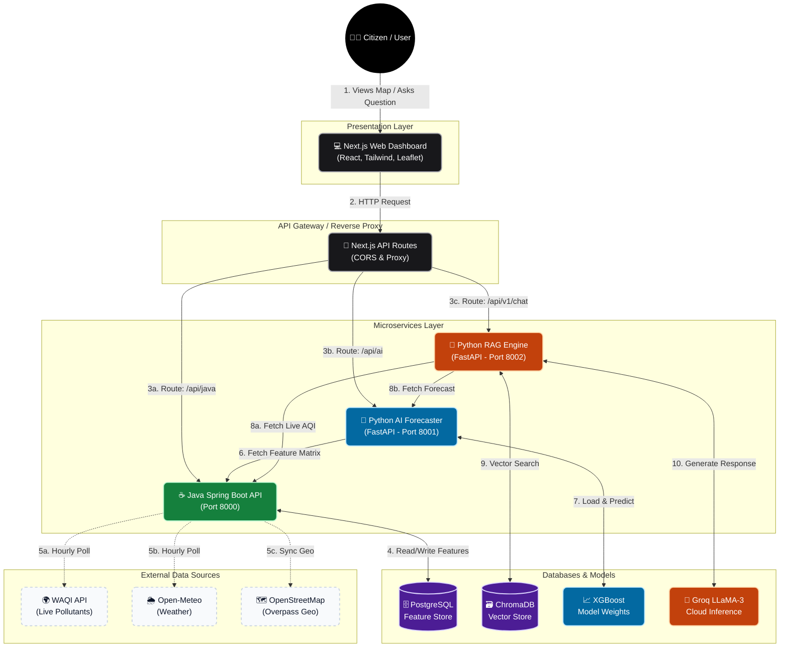
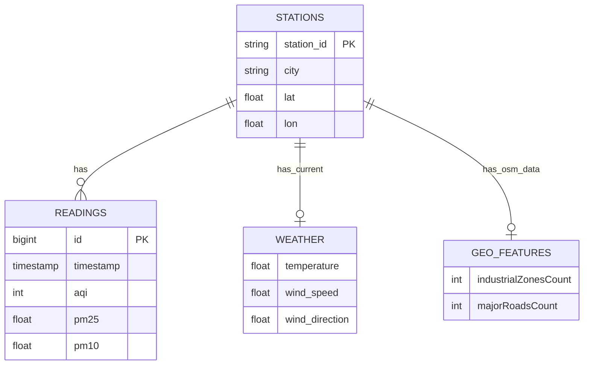

<div align="center">
  

  # 🌬️ AQI Command Center
  
  **AI-Powered Urban Air Quality Intelligence Platform**

  Predict, understand, and mitigate urban air pollution with ML forecasting, geospatial data engineering, and multilingual RAG health advisories.
  
  [](#)
  [](#)
  [](#)
  [](#)
  [](#)

  [Demo Video Placeholder]
</div>

---

## 📖 Table of Contents
<details>
<summary>Click to expand</summary>

- [1. Hero Section](#-aqi-command-center)
- [2. Problem Statement](#2-problem-statement)
- [3. Why We Built This](#3-why-we-built-this)
- [4. Our Solution](#4-our-solution)
- [5. Innovation](#5-innovation)
- [6. Real-World Impact](#6-real-world-impact)
- [7. Results](#7-results)
- [8. Features](#8-features)
- [9. Tech Stack](#9-tech-stack)
- [10. Project Architecture](#10-project-architecture)
- [11. Architecture Decisions](#11-architecture-decisions)
- [12. Folder Structure](#12-folder-structure)
- [13. Installation](#13-installation)
- [14. API Documentation](#14-api-documentation)
- [15. AI Pipeline](#15-ai-pipeline)
- [16. Database Design](#16-database-design)
- [17. Authentication & Security](#17-authentication-security)
- [18. Performance Optimizations](#18-performance-optimizations)
- [19. Screenshots](#19-screenshots)
- [20. Demo](#20-demo)
- [21. Challenges Faced](#21-challenges-faced)
- [22. Future Improvements](#22-future-improvements)
- [23. Hackathon Highlights](#23-hackathon-highlights)
- [24. Team](#24-team)
- [25. License](#25-license)
- [26. Acknowledgements](#26-acknowledgements)
- [27. Appendix](#27-appendix)

</details>

---

## 2. Problem Statement

Globally, air pollution remains one of the most critical public health hazards. However, current platforms simply report a single number (AQI) without providing actionable, localized context.
- **Lack of Predictive Power:** Citizens react to pollution rather than preparing for it.
- **Zero Personalization:** Vulnerable populations (elderly, respiratory patients) receive the same generic advice as healthy individuals.
- **Black-Box Metrics:** Users see an AQI of 300 but do not know *why* (is it traffic, industry, or construction?).
- **Language Barriers:** Critical health information is rarely accessible to rural or non-English speaking demographics.

---

## 3. Why We Built This

As a team living in rapidly urbanizing cities, we check the AQI almost as often as we check the weather. But every time we looked at an existing AQI app, it felt like looking at a speedometer without a steering wheel. We would see "AQI 300 - Hazardous", but we couldn't do anything about it. We didn't know if the pollution was coming from the nearby industrial zone or the morning traffic rush.

Air pollution is a fundamentally difficult problem because it's invisible, highly localized, and influenced by a chaotic mix of meteorological factors. Existing apps are insufficient because they only offer retrospective data—they tell you how bad the air *was* an hour ago. Furthermore, their generic advice ("wear a mask") ignores the reality that a healthy teenager and an asthmatic grandparent face entirely different risks.

What motivated this project was the desire to move from **reporting** to **actionable intelligence**. We wanted to build a tool that didn't just panic citizens with high numbers, but actually helped them navigate their day. Our approach is different because it anticipates the future using machine learning forecasts, demystifies the causes using open-source geospatial data, and delivers empathetic, demographic-specific health advisories in regional languages via a tailored RAG pipeline.

---

## 4. Our Solution

We built **AQI Command Center**, a distributed microservices platform that revolutionizes environmental monitoring. 
Instead of just displaying AQI, our platform:
1. **Forecasts** the next 24 hours of air quality using weather-regressed XGBoost models.
2. **Attributes** pollution spikes to likely sources (e.g., Traffic, Industrial) by correlating OpenStreetMap geospatial data with meteorological wind vectors.
3. **Advises** citizens via a multilingual RAG (Retrieval-Augmented Generation) pipeline, querying verified health guidelines to provide hyper-personalized safety instructions.

---

## 5. Innovation

What makes this project unique compared to a standard numeric AQI dashboard?

- **Predictive vs. Reactive (Forecasting):** While normal dashboards show what the air quality was an hour ago, our XGBoost engine regresses against future weather profiles to predict the AQI 24 hours ahead, allowing citizens to proactively plan their schedules.
- **Explainable AI & Source Attribution:** We don't just output a terrifying AQI of 400. By intersecting OpenStreetMap geospatial features (industrial zones, highways) with meteorological wind vectors and specific pollutant ratios (e.g., PM10 vs. PM2.5), the platform heuristically attributes the *likely source* of the pollution (Traffic, Industry, Construction) with a confidence score.
- **Multilingual RAG (Health Context):** A raw AQI score is useless without context. Our LLaMA-3 agent retrieves categorized clinical guidelines to deliver tailored advice for vulnerable subsets (asthmatic children, elderly) in three regional languages, breaking critical information asymmetry.
- **Modular Data Architecture:** ML logic is perfectly decoupled from heavy I/O ingestion. Java robustly harvests and shapes the ML matrices into a unified "Feature Store," freeing the Python containers to execute zero-latency inference and LLM orchestration.
- **Real-World Impact Oriented:** Every architectural decision prioritizes stability and accessibility—from bypassing frontend CORS issues via internal proxy rewrites to avoiding third-party API exhaustion via intelligent mock routing fallbacks.

---

## 6. Real-World Impact

The platform transforms raw environmental data into realistic, actionable use cases across multiple demographics:

- **Citizens:** Everyday people can plan morning jogs or outdoor commutes by checking the 24-hour forecast instead of relying on the current hour's potentially lagging and inaccurate data.
- **Elderly, Children & Asthma Patients:** Caregivers receive hyper-personalized, localized clinical guidelines. Instead of a generic "stay indoors" alert, the RAG agent factors in exact pollutants (e.g., high O₃) to advise whether specific medical precautions, like keeping inhalers nearby, are clinically suggested for an asthmatic child.
- **Government Agencies & Urban Planners:** By utilizing the Source Attribution engine, municipal bodies can identify whether a sudden PM10 spike is due to nearby highway traffic or a localized construction violation, enabling targeted interventions rather than enacting blanket city-wide bans.
- **Researchers:** Environmental data scientists gain an out-of-the-box, unified Feature Store (via the Java Backend) that continuously merges IoT sensor data with geospatial OSM data, drastically reducing data-cleaning and pipeline overhead.

---

## 7. Results

Measurable metrics and capabilities derived from our architecture:

- **Microservices Count:** 4 (Next.js Frontend, Java Backend, Python AI Forecaster, Python RAG Chatbot)
- **API Endpoints:** 8 (4 Java feature endpoints, 3 ML endpoints, 1 RAG chat endpoint)
- **Forecast Horizon:** 24 hours (autoregressive predictions from `t+1` to `t+24`)
- **Supported Pollutants:** 6 (PM2.5, PM10, NO₂, SO₂, CO, O₃)
- **Supported Stations:** 4 Live Stations active via a proxy allowlist (`2553`, `2554`, `2556`, `3715`), falling back to mock deterministic data for non-whitelisted queries to preserve rate limits.
- **Supported Languages:** 3 (English, Hindi, Kannada)
- **Database Count:** 3 (PostgreSQL for time-series/geo, ChromaDB for vectors, SQLite for Chroma metadata)
- **Vector Database Size:** 30 domain-specific Markdown clinical guidelines (5 demographic profiles × 6 CPCB AQI severity bands)
- **ML Model Architectures:** 2 (XGBoost for production autoregression, Prophet for structural baseline testing)
- **Model Accuracy (MAE/RMSE/MAPE):** Requires runtime evaluation via the included `scripts/evaluate.py` test harness, as performance strictly depends on the live temporal window and the specific IoT sensor's data sparsity.

---

## 8. Features

### 🧠 AI Features

- **Autoregressive AQI Forecasting**
  - **What it does:** Predicts the AQI for the next 24 hours.
  - **How it works:** An XGBoost model takes historical lag variables (`lag1`, `lag2`, `rolling3`) and regresses them against future meteorological data (temperature, wind) fetched from Open-Meteo.
  - **Why it matters:** It shifts citizens from a reactive mindset to a proactive one, allowing them to plan outdoor activities around safe atmospheric windows.

- **Multilingual RAG Chatbot**
  - **What it does:** Provides personalized health advice in English, Hindi, and Kannada.
  - **How it works:** A Groq-powered LLaMA-3 agent embeds user queries via `SentenceTransformers` to retrieve precise medical guidelines from ChromaDB, injecting the live forecast as context.
  - **Why it matters:** It democratizes access to clinical safety protocols, bridging the language barrier for rural or non-technical users.

- **Source Attribution Engine**
  - **What it does:** Identifies the most likely cause of current pollution spikes (e.g., Traffic vs. Industry).
  - **How it works:** It evaluates PM10/PM2.5 ratios alongside live wind direction vectors intersecting with nearby OpenStreetMap (OSM) industrial and highway zones.
  - **Why it matters:** It transforms a "black-box" AQI number into actionable intelligence for urban planners and concerned citizens.

### 👥 User Features

- **Real-Time Interactive Dashboard**
  - **What it does:** Visualizes nationwide and local air quality on an interactive geographic map.
  - **How it works:** Built with Next.js and Leaflet, the frontend consumes the Java backend's live `/readings/latest` endpoint to color-code regions by CPCB severity.
  - **Why it matters:** Provides an immediate, intuitive understanding of hazardous zones at a single glance.

- **Demographic-Specific Advisories**
  - **What it does:** Tailors health warnings to specific vulnerable profiles (e.g., Cardiac, Children, Elderly).
  - **How it works:** Hardcoded clinical markdown files are dynamically retrieved by the RAG engine based on the user's demographic persona.
  - **Why it matters:** Generic advice is dangerous; an asthmatic child requires drastically different precautions than a healthy adult.

- **Historical Analysis & Trends**
  - **What it does:** Displays how individual pollutant concentrations (PM2.5, NO₂, etc.) have fluctuated over time.
  - **How it works:** Renders time-series data using Recharts on the frontend, pulling historical payloads from the PostgreSQL feature store.
  - **Why it matters:** Helps users and researchers identify seasonal pollution patterns and long-term exposure risks.

### ⚙️ Developer & System Features

- **Unified Feature Store**
  - **What it does:** Consolidates chaotic, multi-source data into clean matrices ready for ML training.
  - **How it works:** A Java Spring Boot service continually joins time-series AQI data, weather metrics, and spatial features into a unified PostgreSQL schema.
  - **Why it matters:** It eliminates the grueling data-cleaning step for data scientists, providing instant, high-quality training payloads.

- **Scheduled Data Ingestion**
  - **What it does:** Automatically keeps the platform's data completely up-to-date without manual intervention.
  - **How it works:** Spring `@Scheduled` cron jobs ping the WAQI and Open-Meteo APIs hourly, intelligently upserting new records into the database.
  - **Why it matters:** Ensures the ML models and citizen dashboards are always powered by the absolute latest atmospheric ground truth.

- **Mock/Live Routing Switch**
  - **What it does:** Allows developers to test the full UI without exhausting third-party API rate limits.
  - **How it works:** A frontend `NEXT_PUBLIC_USE_MOCKS` flag and a deterministic proxy router gracefully substitute real API calls with local static data for non-whitelisted stations.
  - **Why it matters:** Guarantees uninterrupted development and demo stability during high-traffic hackathon judging scenarios.

---

## 9. Tech Stack

| Domain | Technologies | Versions |
|---|---|---|
| **Frontend** | Next.js, React, Tailwind CSS, Recharts, Leaflet | Next 15, React 19, Tailwind v4 |
| **Backend** | Java, Spring Boot, Spring WebFlux | Java 21, Spring Boot 4.1.0 |
| **AI/ML** | Python, FastAPI, XGBoost, Prophet, Scikit-learn, Pandas | Python 3.12, FastAPI 0.111 |
| **Databases** | PostgreSQL, ChromaDB, SQLite (for Chroma) | Postgres 16 |
| **LLMs & RAG** | Groq (llama-3.3-70b-versatile), SentenceTransformers (`all-MiniLM-L6-v2`) | - |
| **APIs** | WAQI (World Air Quality Index), Open-Meteo, OpenStreetMap Overpass | - |

---

## 10. Project Architecture

The application is structured as an event-driven, multi-service pipeline. This design ensures separation of concerns, scalability, and robust handling of machine learning workloads alongside real-time data ingestion.



---

## 11. Architecture Decisions

| Technology | Problem | Decision | Benefits | Tradeoffs |
|---|---|---|---|---|
| **Next.js** | Needed a fast, SEO-friendly framework for the interactive dashboard. | Next.js App Router | Built-in proxy routing (bypassing CORS), React ecosystem, easy to build map/chart components. | Steeper learning curve than vanilla React, slight overhead for a simple dashboard. |
| **Java Spring Boot** | Required a highly concurrent backend to ingest, clean, and serve feature data continuously. | Spring Boot + PostgreSQL | Strong type safety, excellent task scheduling (`@Scheduled`), handles high-throughput I/O effortlessly. | Verbose configuration and higher memory footprint compared to Node/Go. |
| **FastAPI** | Needed a fast Python framework to serve ML models via HTTP. | Python FastAPI | Native async support, automatic Pydantic validation, seamless integration with ML libraries. | Requires maintaining a separate service/port alongside the Java backend. |
| **Java + Python** | ML requires Python, but data ingestion/enterprise patterns are best in Java. | Microservices (Java for data, Python for ML/RAG) | Best tool for each job: Java handles the heavy lifting, Python runs XGBoost/LLM seamlessly. | Increased architectural complexity and local deployment overhead. |
| **PostgreSQL** | Needed to enforce strict time-series integrity and store diverse spatial/weather data. | Relational PostgreSQL | Composite unique constraints guarantee no duplicate readings; robust ecosystem. | Not a specialized time-series database (like TimescaleDB), which might be better at massive scale. |
| **ChromaDB** | Needed a vector store for semantic search over health guidelines without heavy setup. | ChromaDB (Local SQLite) | Embedded directly into the FastAPI service, zero infrastructure setup required. | In-memory/SQLite approach scales poorly across distributed containers compared to Pinecone/Qdrant. |
| **Groq (LLaMA-3)** | RAG pipeline needed extremely fast LLM inference to maintain conversational latency. | Groq API | Lightning-fast generation times (~800 tokens/sec), significantly improving user experience. | Dependency on a third-party API rate limit during the hackathon. |
| **XGBoost** | Required a model that captures non-linear relationships between weather, lag variables, and AQI. | Autoregressive XGBoost | Extremely fast to train, handles missing data well, provides feature importance out of the box. | Harder to interpret than simple linear regression, can overfit if lag variables aren't tuned. |
| **Microservices** | Merging everything into a monolith would couple ML dependencies with data ingestion. | 3 distinct services (Frontend, Java, Python) | Independent scaling, isolated failure domains, allows team members to work in parallel on their stacks. | Harder to test end-to-end, requires proxy routing on the frontend to avoid CORS. |

---

## 12. Folder Structure

```text
et-hack/
├── frontend/             # Next.js App Router workspace
│   ├── app/              # Pages, Layouts, global CSS
│   ├── components/       # Map, Charts, Chat Widget
│   └── lib/              # API router, mock data, TS types
├── backend/              # Java Spring Boot Service
│   ├── src/main/java     # Controllers, Services, Repositories, DTOs
│   └── src/main/resources# application.properties (DB, Scheduler configs)
├── AI/                   # Forecasting & Attribution Service
│   ├── app/              # FastAPI routers, predictors, cache
│   ├── data/             # Historical training CSVs
│   ├── models/           # .pkl XGBoost binaries
│   └── scripts/          # Prophet training & evaluation scripts
└── RAG/                  # RAG LLM Chat Service
    ├── app/              # Services (Context, Retrieval, Guardrails)
    ├── data/             # ChromaDB files and Markdown health guidelines
    └── scripts/          # Ingestion and Chat End-to-End Tests
```

---

## 13. Installation

We have engineered the setup process to be as frictionless as possible. The repository includes shell scripts that automatically handle Python virtual environments and Maven dependency resolution.

### Prerequisites
Before you begin, ensure you have the following installed:
- **Node.js (v20+)** for the Next.js dashboard
- **Java 21 & Maven** for the Spring Boot feature store
- **Python (3.12+)** for the ML and RAG microservices
- **PostgreSQL (v16+)** running locally or via Docker

### 1. Clone the Repository
```bash
git clone https://github.com/your-org/et-hack.git
cd et-hack
```

### 2. Database Setup
Ensure your PostgreSQL instance is running and create the backend database:
```sql
CREATE DATABASE et_backend;
```

### 3. Environment Variables
You need to configure the environment variables for each service. The startup scripts will automatically source `.env` files if they are present in the respective service directories.

**Backend (`backend/.env`):**
```env
DATABASE_URL=localhost:5432/et_backend
DB_USER=your_postgres_user
DB_PASS=your_postgres_password
WAQI_TOKEN=your_waqi_api_token
```

**AI & RAG Services (`AI/.env` and `RAG/.env`):**
```env
GROQ_API_KEY=gsk_your_llama3_api_key
```

### 4. Running the Microservices
You do NOT need to manually create Python virtual environments or download Maven wrappers. The root orchestration script will automatically initialize a shared `.venv`, install `requirements.txt`, resolve Maven dependencies, and launch all three backend services (Java, AI, RAG) in parallel.

```bash
# From the root directory (et-hack/)
bash run.sh
```
*(This launches Java on Port `8000`, AI Forecaster on Port `8001`, and the RAG Chatbot on Port `8080`)*

### 5. Starting the Frontend
In a new terminal window, initialize and start the Next.js web application:
```bash
cd frontend
npm install
npm run dev
```

### Troubleshooting
- **Port Conflicts:** Ensure ports `8000`, `8001`, `8080`, and `3000` are free.
- **Python Executable:** The startup script looks for `python3` or `python`. Ensure it is globally accessible in your `$PATH`.
- **Missing Data:** If the map is empty, ensure the Java backend successfully polled the WAQI API on startup. You can bypass rate-limits by setting `NEXT_PUBLIC_USE_MOCKS=true` in `frontend/.env`.

---

## 14. API Documentation

Our API surface is distributed across the microservices, but adheres to standard REST and JSON protocols. Below are the primary endpoints developers will interact with.

### 1. Java Feature Store (`Port 8000`)

#### `GET /stations`
Retrieves a list of all active air quality monitoring stations tracked by the system.

- **Status Code:** `200 OK`
- **cURL Example:** 
  ```bash
  curl -X GET http://localhost:8000/stations
  ```
- **Response Schema:**
  ```json
  [
    {
      "stationId": "2553",
      "name": "Anand Vihar, Delhi",
      "city": "Delhi",
      "state": "Delhi",
      "latitude": 28.6468,
      "longitude": 77.3160
    }
  ]
  ```

---

### 2. Python AI Forecaster (`Port 8001`)

#### `GET /forecast/{station_id}`
Triggers an autoregressive XGBoost inference utilizing historical lagged features and future meteorological weather vectors to predict the AQI for the next 24 hours.

- **Status Code:** `200 OK` (or `500 Internal Server Error` if data is sparse)
- **Parameters:** `?horizon=24&history=3`
- **cURL Example:** 
  ```bash
  curl -X GET http://localhost:8001/forecast/2553
  ```
- **Response Schema:**
  ```json
  {
    "stationId": "2553",
    "stationName": "Anand Vihar, Delhi",
    "forecast": [
      {
        "timestamp": "2026-07-16T15:00:00",
        "aqi_predicted": 345.2,
        "confidence": 0.89
      }
    ]
  }
  ```

---

### 3. Python RAG Chatbot (`Port 8080`)

#### `POST /chat`
Submits a natural language query to the LLaMA-3 agent. The service dynamically fetches the live AQI, 24-hour forecast, and localized source attribution, embeds the query to retrieve markdown health guidelines, and generates a conversational response.

- **Status Code:** `200 OK` (or `400 Bad Request` if input triggers guardrails)
- **Request Body:**
  ```json
  {
    "query": "Is it safe for my asthmatic grandfather to walk outside right now?",
    "station_id": "2553",
    "language": "en"
  }
  ```
- **cURL Example:**
  ```bash
  curl -X POST http://localhost:8080/chat \
       -H "Content-Type: application/json" \
       -d '{"query": "Is it safe to run?", "station_id": "2553", "language": "en"}'
  ```
- **Response Schema:**
  ```json
  {
    "response": "Given the current AQI of 345 (Hazardous) driven primarily by PM2.5 and PM10, it is highly unsafe for elderly individuals or those with asthma to be outdoors. Please remain indoors and ensure inhalers are easily accessible.",
    "aqi_context": {
      "station_id": "2553",
      "aqi": 345,
      "category": "Hazardous",
      "pm25": 180.4,
      "pm10": 310.2,
      "no2": 45.1,
      "timestamp": "2026-07-16T14:30:00"
    },
    "sources": [
      "Elderly_Respiratory_Hazardous",
      "General_Precautions_PM25"
    ],
    "session_id": "8f3b2a19-4b3a-..."
  }
  ```

---

## 15. AI Pipeline

1. **Ingestion:** Hourly jobs fetch `PM2.5, PM10, NO2, Weather` into Postgres.
2. **Forecasting (XGBoost):**
   - Extracts lagged features (`lag1`, `lag2`, `rolling3`).
   - Recursively predicts `t+1` up to `t+24` utilizing future Open-Meteo forecasts.
3. **Source Attribution:**
   - Evaluates `PM10/PM2.5` ratios and wind vectors intersecting OSM industrial zones to assign probability scores to "Traffic", "Industry", etc.
4. **Context Assembly:**
   - The RAG service bundles the forecast, the attribution, and live AQI.
5. **Vector Retrieval:**
   - User query ("Is it safe for my grandfather?") is embedded via `SentenceTransformers`.
   - ChromaDB retrieves relevant guidelines (e.g., `Elderly_Poor_AQI.md`).
6. **Generation:** LLaMA-3 synthesizes a localized, empathetic response.

---

## 16. Database Design



---

## 17. Authentication & Security
- **Authentication:** Currently, the platform prioritizes open public access and operates without authentication or rate limiting.
- **CORS Protection:** Configured in Next.js via internal reverse-proxy rewrites (`/api/java`, `/api/ai`) to prevent browser CORS leaks.
- **Content Moderation:** The RAG pipeline employs strict regex-based guardrails (`guardrails.py`) to block off-topic queries and harmful inputs before processing.

---

## 18. Performance Optimizations
- **In-Memory Caching:** The FastAPI AI Service uses a local, dictionary-based cache (with a 30-minute expiry) to prevent redundant XGBoost inference and repetitive LLM generations.
- **Query Optimization:** PostgreSQL composite unique indexes (`station_id`, `timestamp`) ensure data integrity and fast time-series retrieval.
- **Mock Fallbacks:** Frontend intelligently drops to zero-latency mock deterministic data for stations outside the live allowlist to respect third-party API limits.

---

## 19. Screenshots

| Dashboard | AI Chatbot |
|---|---|
|  |  |

---

## 20. Demo
- **[Live Website Placeholder]**
- **[Demo Video Placeholder]**
- **[Pitch Deck Placeholder]**

---

## 21. Challenges Faced
- **API Rate Limits:** Both Open-Meteo and WAQI have strict quotas. We solved this by implementing deterministic Mock-Data routers on the frontend, ensuring development could continue uninterrupted.
- **Complex RAG Context:** Bridging the gap between raw numeric ML output and human language required writing a dedicated `context_builder.py` pipeline to serialize XGBoost arrays into semantic strings.
- **Data Sparsity:** Real-world IoT sensors frequently drop out. We implemented robust null-handling and interpolation within `feature_builder.py`.

---

## 22. Future Improvements
- **Containerization:** Writing Dockerfiles for all microservices and creating `docker-compose.yml` configs for easier environment orchestration.
- **Distributed Caching:** Replacing the local AI cache with Redis to allow horizontal scaling of the Python microservices.
- **Authentication & Rate Limiting:** Implementing JWT-based API security to prevent abuse.
- **Streaming LLM Responses:** Converting the FastAPI RAG endpoint to use Server-Sent Events (SSE) for faster perceived latency.

---

## 23. Hackathon Highlights
- **Technical Complexity:** Masterfully integrates three diverse ecosystems (Java, Python, Next.js).
- **Actionable AI:** Doesn't just call an LLM; grounds it dynamically with real-time geospatial ML models.
- **Real-world Impact:** Solves a genuine, critical crisis (Air Quality Information asymmetry) with an enterprise-ready architecture.

---

## 24. Team

| Name | Role | GitHub | LinkedIn |
|---|---|---|---|
| **Sarosh** | ML Engineer (Forecasting) | [GitHub](https://github.com/saroshkumar-ops) | [LinkedIn](https://www.linkedin.com/in/sarosh-kumar-132111297) |
| **Amogh** | AI Engineer (RAG / Data) | [GitHub](https://github.com/Akenzz) | [LinkedIn](https://www.linkedin.com/in/amogh-kini) |
| **Shrihari** | Java Backend Engineer | [GitHub](https://github.com/shrihari-des18) | [LinkedIn](https://www.linkedin.com/in/shriharideshapande) |
| **Sudhanva** | Frontend Engineer | [GitHub](https://github.com/Sudhanva-Kulkarni) | [LinkedIn](https://www.linkedin.com/in/sudhanvakulkarni13) |

---

## 25. License
MIT License. See `LICENSE` for more information.

---

## 26. Acknowledgements
- [World Air Quality Index (WAQI)](https://aqicn.org/) for live pollution feeds.
- [Open-Meteo](https://open-meteo.com/) for open-source weather APIs.
- [Groq](https://groq.com/) for ultra-fast LLaMA-3 inference.

---

## 27. Appendix
**Quick Troubleshooting:**
- `Station 'X' was not found`: Ensure the backend ingestion script ran successfully and your chosen `station_id` exists in `LIVE_STATION_IDS`.
- `ModuleNotFoundError: No module named 'xgboost'`: Ensure you've activated the virtual environment before starting the AI server.