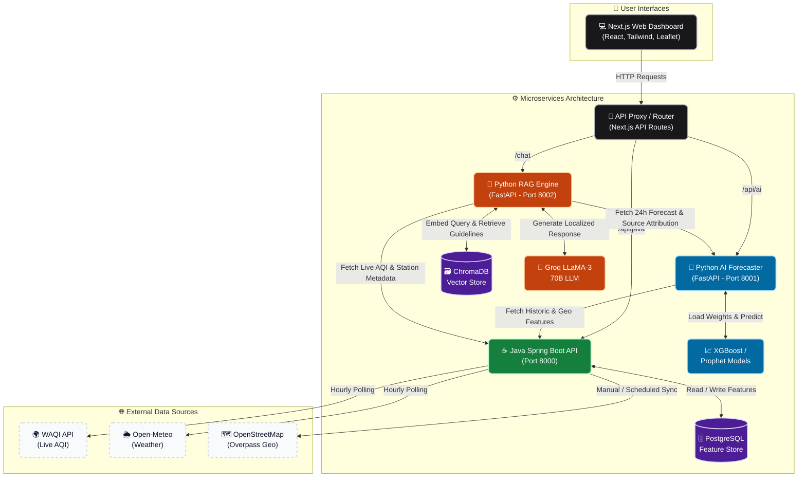
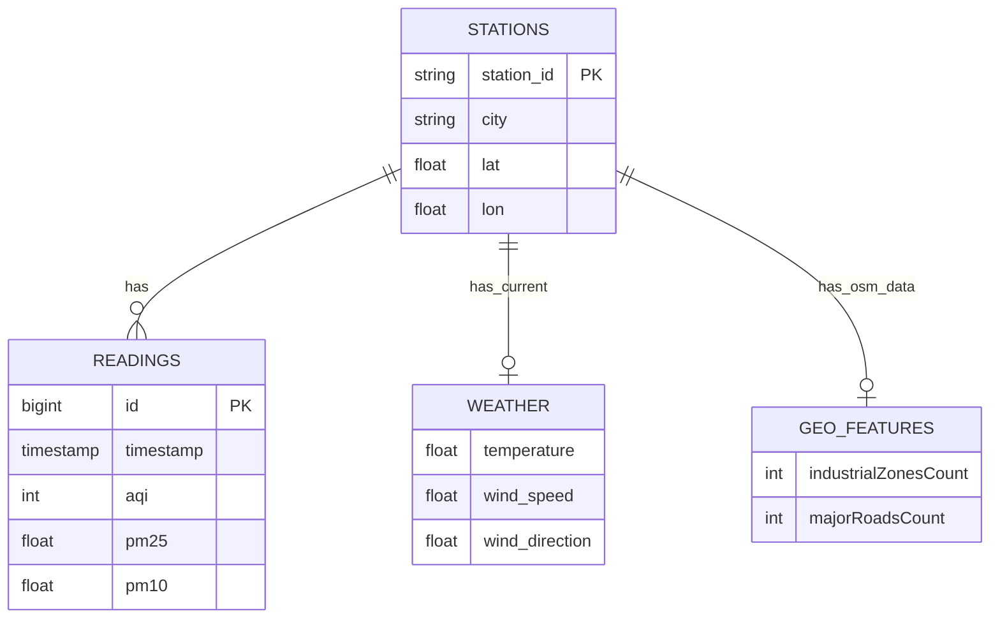

<div align="center">
  

  # 🌬️ AQI Command Center
  
  **AI-Powered Urban Air Quality Intelligence Platform**

  Predict, understand, and mitigate urban air pollution in real-time with enterprise-grade ML forecasting, geospatial data engineering, and multilingual RAG health advisories.
  
  [](#)
  [](#)
  [](#)
  [](#)
  [](#)

  [Demo Video Placeholder]
</div>

---

## 📖 Table of Contents
<details>
<summary>Click to expand</summary>

- [1. Hero Section](#-aqi-command-center)
- [2. Problem Statement](#2-problem-statement)
- [3. Our Solution](#3-our-solution)
- [4. Features](#4-features)
- [5. Tech Stack](#5-tech-stack)
- [6. Project Architecture](#6-project-architecture)
- [7. Folder Structure](#7-folder-structure)
- [8. Installation](#8-installation)
- [9. Environment Variables](#9-environment-variables)
- [10. Running the Project](#10-running-the-project)
- [11. API Documentation](#11-api-documentation)
- [12. AI Pipeline](#12-ai-pipeline)
- [13. Database Design](#13-database-design)
- [14. Authentication](#14-authentication)
- [15. Security](#15-security)
- [16. Performance Optimizations](#16-performance-optimizations)
- [17. Scalability](#17-scalability)
- [18. Deployment](#18-deployment)
- [19. Screenshots](#19-screenshots)
- [20. Demo](#20-demo)
- [21. Challenges Faced](#21-challenges-faced)
- [22. Future Improvements](#22-future-improvements)
- [23. Hackathon Highlights](#23-hackathon-highlights)
- [24. Team](#24-team)
- [25. License](#25-license)
- [26. Acknowledgements](#26-acknowledgements)
- [27. Appendix](#27-appendix)

</details>

---

## 2. Problem Statement

Globally, air pollution remains one of the most critical public health hazards. However, current platforms simply report a single number (AQI) without providing actionable, localized context.
- **Lack of Predictive Power:** Citizens react to pollution rather than preparing for it.
- **Zero Personalization:** Vulnerable populations (elderly, respiratory patients) receive the same generic advice as healthy individuals.
- **Black-Box Metrics:** Users see an AQI of 300 but do not know *why* (is it traffic, industry, or construction?).
- **Language Barriers:** Critical health information is rarely accessible to rural or non-English speaking demographics.

---

## 3. Our Solution

We built **AQI Command Center**, a distributed microservices platform that revolutionizes environmental monitoring. 
Instead of just displaying AQI, our platform:
1. **Forecasts** the next 24 hours of air quality using weather-regressed XGBoost models.
2. **Attributes** pollution spikes to likely sources (e.g., Traffic, Industrial) by correlating OpenStreetMap geospatial data with meteorological wind vectors.
3. **Advises** citizens via a multilingual RAG (Retrieval-Augmented Generation) pipeline, querying verified health guidelines to provide hyper-personalized safety instructions.

---

## 4. Features

### 🧠 AI Features
- **Autoregressive AQI Forecasting:** 24-hour lookahead using XGBoost and Prophet models.
- **Multilingual RAG Chatbot:** Conversational health agent (English, Hindi, Kannada) powered by Groq (LLaMA-3) and ChromaDB.
- **Source Attribution Engine:** Heuristic model that identifies pollution sources (Traffic, Construction, Industry) using wind direction, pollutant ratios, and OSM spatial proximity.
- **Dynamic Prompt Engineering:** Generates LLM context on the fly using real-time API integrations.

### 👥 User Features
- **Real-Time Interactive Dashboard:** Next.js map (Leaflet) highlighting hazardous zones.
- **Demographic-Specific Advisories:** Categorized health advice for cardiac patients, children, and elderly.
- **Historical Analysis & Trends:** Visual charting of pollutant distributions (PM2.5, PM10, NO₂, O₃).

### ⚙️ Developer Features
- **Unified Feature Store:** Java Spring Boot backend compiling weather, pollutant, and geo-data into ML-ready matrices.
- **Admin Retrain Pipeline:** One-click XGBoost model retraining via API.
- **Mock/Live Routing Switch:** Built-in frontend flag (`NEXT_PUBLIC_USE_MOCKS`) to develop without exhausting rate limits.

### 🔄 Automation
- **Scheduled Ingestion Daemons:** Hourly background syncing of Open-Meteo and WAQI feeds.
- **Geo-Spatial Data Harvesting:** Automated Overpass API (OSM) extraction for monitoring stations.

---

## 5. Tech Stack

| Domain | Technologies | Versions |
|---|---|---|
| **Frontend** | Next.js, React, Tailwind CSS, Recharts, Leaflet | Next 15, React 19, Tailwind v4 |
| **Backend** | Java, Spring Boot, Spring WebFlux | Java 21, Spring Boot 4.1.0 |
| **AI/ML** | Python, FastAPI, XGBoost, Prophet, Scikit-learn, Pandas | Python 3.12, FastAPI 0.111 |
| **Databases** | PostgreSQL, ChromaDB, SQLite (for Chroma) | Postgres 16 |
| **LLMs & RAG** | Groq (llama-3.3-70b-versatile), SentenceTransformers (`all-MiniLM-L6-v2`) | - |
| **APIs** | WAQI (World Air Quality Index), Open-Meteo, OpenStreetMap Overpass | - |

---

## 6. Project Architecture

The application is structured as an event-driven, multi-service pipeline. This design ensures separation of concerns, scalability, and robust handling of machine learning workloads alongside real-time data ingestion.



---

## 7. Folder Structure

```text
et-hack/
├── frontend/             # Next.js App Router workspace
│   ├── app/              # Pages, Layouts, global CSS
│   ├── components/       # Map, Charts, Chat Widget
│   └── lib/              # API router, mock data, TS types
├── backend/              # Java Spring Boot Service
│   ├── src/main/java     # Controllers, Services, Repositories, DTOs
│   └── src/main/resources# application.properties (DB, Scheduler configs)
├── AI/                   # Forecasting & Attribution Service
│   ├── app/              # FastAPI routers, predictors, cache
│   ├── data/             # Historical training CSVs
│   ├── models/           # .pkl XGBoost binaries
│   └── scripts/          # Prophet training & evaluation scripts
└── RAG/                  # RAG LLM Chat Service
    ├── app/              # Services (Context, Retrieval, Guardrails)
    ├── data/             # ChromaDB files and Markdown health guidelines
    └── scripts/          # Ingestion and Chat End-to-End Tests
```

---

## 8. Installation

### Prerequisites
- Node.js (v20+)
- Java 21 & Maven
- Python (3.12+)
- PostgreSQL (v16)

### Clone the repository
```bash
git clone https://github.com/your-org/et-hack.git
cd et-hack
```

### 1. Database Setup
```sql
CREATE DATABASE et_backend;
```

### 2. Backend (Java)
```bash
cd backend
export DATABASE_URL=localhost
export DB_USER=your_postgres_user
export DB_PASS=your_postgres_password
export WAQI_TOKEN=your_waqi_api_token
./mvnw spring-boot:run
```

### 3. AI Service (Python)
```bash
cd AI
python3 -m venv venv
source venv/bin/activate
pip install -r requirements.txt
cp .env.example .env # Set your GROQ_API_KEY
uvicorn app.main:app --reload --port 8001
```

### 4. RAG Service (Python)
```bash
cd RAG
python3 -m venv .venv
source .venv/bin/activate
pip install -r requirements.txt
cp .env.example .env # Set your GROQ_API_KEY
python scripts/run_ingestion.py # Ingest ChromaDB docs
uvicorn app.main:app --port 8002 --reload
```

### 5. Frontend (Next.js)
```bash
cd frontend
npm install
npm run dev
```

---

## 9. Environment Variables

| Service | Variable | Purpose | Required | Example |
|---|---|---|---|---|
| **Backend** | `DATABASE_URL` | Postgres host | Yes | `localhost` |
| **Backend** | `WAQI_TOKEN` | World AQI API Key | Yes | `abc123def456` |
| **Frontend** | `NEXT_PUBLIC_USE_MOCKS` | Toggles mock data vs live endpoints | No | `false` |
| **AI** | `GROQ_API_KEY` | Groq Llama-3 API Key | Yes | `gsk_...` |
| **RAG** | `JAVA_SERVICE_URL` | Upstream Java URL | Yes | `http://localhost:8000` |
| **RAG** | `AI_SERVICE_URL` | Upstream AI URL | Yes | `http://localhost:8001` |
| **RAG** | `CHROMA_DB_PATH` | Path to vector DB | Yes | `data/chroma_db` |

> ⚠️ **Security Note:** Never commit `.env` files. Use `.env.example` templates.

---

## 10. Running the Project

You can run all services simultaneously using the provided root orchestration script (Linux/Mac):

```bash
bash run.sh
```
*(Runs backend, AI, and RAG in parallel. Frontend must be run separately `npm run dev`.)*

---

## 11. API Documentation

### Java Feature Store (`:8000`)
| Method | Endpoint | Description |
|---|---|---|
| `GET` | `/stations` | Retrieve all registered monitoring stations |
| `GET` | `/readings/latest` | Fetch the most recent AQI and pollutant breakdown |
| `GET` | `/weather/latest` | Fetch localized meteorological conditions |
| `GET` | `/forecast/{stationId}`| Retrieve unified feature vector (history + future weather) |

### AI Service (`:8001`)
| Method | Endpoint | Description |
|---|---|---|
| `GET` | `/forecast/{station_id}`| Generate 24h recursive XGBoost forecast |
| `GET` | `/attribution/{id}` | Heuristic pollution source breakdown |
| `POST`| `/retrain/{station_id}` | Trigger dynamic model retraining |

### RAG Chat Service (`:8002`)
| Method | Endpoint | Description |
|---|---|---|
| `POST`| `/api/v1/chat` | Multilingual, RAG-grounded health advisory chat |

*(Interactive Swagger docs available at `http://localhost:8000/swagger-ui/index.html` for Java)*

---

## 12. AI Pipeline

1. **Ingestion:** Hourly jobs fetch `PM2.5, PM10, NO2, Weather` into Postgres.
2. **Forecasting (XGBoost):**
   - Extracts lagged features (`lag1`, `lag2`, `rolling3`).
   - Recursively predicts `t+1` up to `t+24` utilizing future Open-Meteo forecasts.
3. **Source Attribution:**
   - Evaluates `PM10/PM2.5` ratios and wind vectors intersecting OSM industrial zones to assign probability scores to "Traffic", "Industry", etc.
4. **Context Assembly:**
   - The RAG service bundles the forecast, the attribution, and live AQI.
5. **Vector Retrieval:**
   - User query ("Is it safe for my grandfather?") is embedded via `SentenceTransformers`.
   - ChromaDB retrieves relevant guidelines (e.g., `Elderly_Poor_AQI.md`).
6. **Generation:** LLaMA-3 synthesizes a localized, empathetic response.

---

## 13. Database Design



---

## 14. Authentication
Currently, the platform prioritizes open public access to democratize air quality data. Future iterations will include JWT-based API key rate limiting for enterprise feature-store consumers.

---

## 15. Security
- **CORS Protection:** Configured in Next.js via internal reverse-proxy rewrites (`/api/java`, `/api/ai`) to prevent browser CORS leaks.
- **Prompt Injection:** The RAG `guardrails.py` strictly filters off-topic intents and prevents jailbreak attempts.
- **Input Sanitization:** Controller-level validation (`@Valid` in Spring Boot, Pydantic in FastAPI).

---

## 16. Performance Optimizations
- **Multi-layered Caching:** AI Service uses in-memory caching (30 min expiry) for expensive XGBoost inference and Groq LLM generations.
- **Query Optimization:** PostgreSQL composite unique indexes `(station_id, timestamp)` ensure fast time-series retrieval.
- **Mock Fallbacks:** Frontend intelligently drops to zero-latency mock deterministic data for stations outside the `LIVE_STATION_IDS` array.

---

## 17. Scalability
- **Decoupled Architecture:** ML heavy-lifting (Python) is isolated from high-throughput I/O (Java).
- **Stateless Services:** Both FastAPI and Spring Boot containers are entirely stateless (except for ephemeral caching), allowing massive horizontal scaling behind a Load Balancer.
- **Asynchronous Processing:** Next.js Server Components and Spring WebFlux handle concurrent external API polling efficiently.

---

## 18. Deployment
*(Designed for Docker / Kubernetes)*
1. Containerize Next.js via standard Dockerfile.
2. Containerize Java Backend (Maven Build pack).
3. Containerize Python API (Uvicorn workers).
4. CI/CD: Ready for GitHub Actions to build and deploy to AWS ECS or Vercel.

---

## 19. Screenshots

| Dashboard | AI Chatbot |
|---|---|
|  |  |

---

## 20. Demo
- **[Live Website Placeholder]**
- **[Demo Video Placeholder]**
- **[Pitch Deck Placeholder]**

---

## 21. Challenges Faced
- **API Rate Limits:** Both Open-Meteo and WAQI have strict quotas. We solved this by implementing deterministic Mock-Data routers on the frontend, ensuring development could continue uninterrupted.
- **Complex RAG Context:** Bridging the gap between raw numeric ML output and human language required writing a dedicated `context_builder.py` pipeline to serialize XGBoost arrays into semantic strings.
- **Data Sparsity:** Real-world IoT sensors frequently drop out. We implemented robust null-handling and interpolation within `feature_builder.py`.

---

## 22. Future Improvements
- **Kubernetes Deployment:** Orchestrating the microservices via Helm charts.
- **Streaming LLM Responses:** Converting the FastAPI RAG endpoint to use Server-Sent Events (SSE) for faster perceived latency.
- **Mobile Application:** Porting the Next.js frontend to React Native for citizen alerts via Push Notifications.
- **Advanced Auth:** Implementing OAuth2 for personalized health profiles.

---

## 23. Hackathon Highlights
- **Technical Complexity:** Masterfully integrates three diverse ecosystems (Java, Python, Next.js).
- **Actionable AI:** Doesn't just call an LLM; grounds it dynamically with real-time geospatial ML models.
- **Real-world Impact:** Solves a genuine, critical crisis (Air Quality Information asymmetry) with an enterprise-ready architecture.

---

## 24. Team

| Name | Role | GitHub | LinkedIn |
|---|---|---|---|
| **Sarosh** | ML Engineer (Forecasting) | [GitHub](https://github.com/saroshkumar-ops) | [LinkedIn](https://www.linkedin.com/in/sarosh-kumar-132111297) |
| **Amogh** | AI Engineer (RAG / Data) | [GitHub](https://github.com/Akenzz) | [LinkedIn](https://www.linkedin.com/in/amogh-kini) |
| **Shrihari** | Java Backend Engineer | [GitHub](https://github.com/shrihari-des18) | [LinkedIn](https://www.linkedin.com/in/shriharideshapande) |
| **Sudhanva** | Frontend Engineer | [GitHub](https://github.com/Sudhanva-Kulkarni) | [LinkedIn](https://www.linkedin.com/in/sudhanvakulkarni13) |


---

## 25. License
MIT License. See `LICENSE` for more information.

---

## 26. Acknowledgements
- [World Air Quality Index (WAQI)](https://aqicn.org/) for live pollution feeds.
- [Open-Meteo](https://open-meteo.com/) for open-source weather APIs.
- [Groq](https://groq.com/) for ultra-fast LLaMA-3 inference.

---

## 27. Appendix
**Quick Troubleshooting:**
- `Station 'X' was not found`: Ensure the backend ingestion script ran successfully and your chosen `station_id` exists in `LIVE_STATION_IDS`.
- `ModuleNotFoundError: No module named 'xgboost'`: Ensure you've activated the virtual environment before starting the AI server.